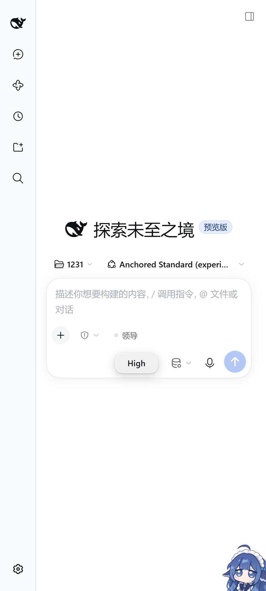

# DSH Mobile

**把 [DeepSeek Harness](https://github.com/deepseek-ai/deepseek-harness)（DSH）打包成一个 Android APK：安装、点图标、直接用。**

不需要电脑、不需要 Termux、不需要 root、不需要导入 rootfs、不需要粘贴 token —— 所有运行时（Debian + Node.js + DSH 本体）都在 APK 里，安装包 894 MB。



---

## 这是什么

官方 DSH 运行时支持 Linux x64/arm64、macOS、Windows，**没有 Android**。本项目用一条「免 root 的 Linux 用户空间」路线把 DSH 原样搬到手机上：

```
APK（assets 里塞着 Debian rootfs + Node 24 + DSH 源码）
  │  首次启动：解压到 App 私有目录（约 3 GB）
  ▼
proot（用户态 chroot/ptrace，无需 root、无需内核支持）
  │
  ▼
Debian 12 (aarch64, glibc)  →  Node.js 24  →  DSH web server (127.0.0.1:3080)
                                                    │
                                                    ▼
                                         App 内置 WebView 直接打开
```

官方 DSH 的目标平台里 **Linux arm64 + glibc 是支持的**，而 Android 自带的 Bionic libc 不兼容（sharp、node-pty、native/system 等都会崩）。所以套一层 Debian 就等于把「Android」伪装成了「官方支持的 linux-arm64」—— 这是整条路线能成立的关键。

## 特性

- **单文件安装**：一个 APK 包含运行时 + DSH，装完即用
- **零配置**：启动时自动解压 rootfs、自动启动 proot/node、自动捕获 `dsh web: http://127.0.0.1:3080/?token=...` 并打开 WebView
- **不需要 root**：proot 是用户态实现，普通 App 权限即可
- **离线可用**：不依赖任何远程服务器（可选局域网补丁通道除外）
- **旧 WebView 兼容**：注入 ES2023/2024 polyfill（`Promise.withResolvers`、`AbortSignal.any` 等），Android 8+ 老内核也能跑 DSH 前端
- **修复补丁机制**：内置 `assets/overlay` 覆盖层 + 可选 `patch.tar.gz` 局域网补丁，小修复不用重新打包
- **可诊断**：内置日志（含网页 console / JS 异常 / WebSocket 生命周期），悬浮「⋯」按钮随时查看、复制

## 安装

1. 下载 `DSH-Mobile.apk`（Release 页）
2. 允许「安装未知来源应用」，安装
3. 首次打开会请求存储权限（允许后 DSH 可以读写手机文件）；解压 rootfs 约需 8–15 分钟
4. 解压完成自动进入 DSH 界面

**需要**：arm64 手机、Android 8.0+、约 4 GB 空闲空间（APK 894 MB + 解压后约 3 GB）。

> APK **不包含任何 API key / 账号信息**，首次使用请在 DSH 里登录或配置自己的模型。

## 自己构建

完整步骤见 [docs/BUILD.md](docs/BUILD.md)。概要：

```powershell
# 0. 准备：JDK 17、Android build-tools 34.0.0、platform android-34
# 1. 从 Termux 取出 proot 运行时（proot / loader / libtalloc / libandroid-shmem）
bash scripts/fetch-runtime.sh            # 在 Termux 里跑，产出 apk/assets/runtime/
# 2. 取原生模块（flock 的 system.node / landlock-run，来自 npm）
bash scripts/fetch-overlay.sh            # 产出 apk/assets/overlay/
# 3. 准备 rootfs.tar.gz（Debian + Node + DSH，见 rootfs/ 下的脚本）
#    放到 apk/rootfs-asset/rootfs.tar.gz
# 4. 打包
powershell -ExecutionPolicy Bypass -File build-apk.ps1
# 产物：dist/DSH-Mobile.apk
```

没有 Gradle：构建链是 `aapt2 → javac → d8 → 追加 dex/rootfs → zipalign → apksigner`，全部手写在一个 PowerShell 脚本里（原因：Android 上可执行文件必须在 targetSdk ≤ 28 的应用里用老式打包方式，Gradle 那套在这里反而更麻烦）。

## 已知限制

- 只有 **arm64-v8a**（没有 x86/armv7 的 rootfs）
- rootfs 与原生模块都是 `linux-arm64 + glibc`，x86 模拟器跑不了
- proot 有性能开销（约 10–30%），耗电比原生高
- App 被系统杀掉后 DSH 进程会中断（暂无前台服务保活）
- 894 MB 体积主要来自 rootfs（复制式 node_modules）；后续可以做去重压缩
- 仅用于个人学习/自用，非官方 DSH 发行版

## 目录结构

```
apk/
  AndroidManifest.xml        # targetSdk 28（关键：允许 exec/dlopen 应用私有目录）
  src/com/dsh/mobile/        # MainActivity（WebView+日志桥）、ProotServer、RuntimeInstaller、TarGzExtractor
  res/                       # 图标（官方 DSH favicon 渲染）、布局、主题
  assets/
    polyfill.js              # ES2023/2024 polyfill
    instrument.js            # console/异常/WebSocket 诊断桥
    runtime/                 # proot 二进制（由 scripts/fetch-runtime.sh 生成）
    overlay/                 # 原生模块覆盖层（由 scripts/fetch-overlay.sh 生成）
    rootfs.tar.gz            # 由 rootfs 脚本生成后放入（不入库）
rootfs/                      # 在 Termux 里构建 Debian+Node+DSH rootfs 的脚本
scripts/                     # 依赖获取、图标渲染、校验脚本
legacy/termux/               # 早期「Termux 里跑」方案，仅存档参考
docs/                        # 构建、架构、踩坑记录
build-apk.ps1                # 无 Gradle 打包脚本
```

## 踩坑记录

构建这类「把 Linux 运行时塞进 Android」的项目有一堆反直觉的坑（targetSdk、proot loader、`--link2symlink`、pnpm workspace、aapt2 大资产压缩、WebView 缺新 API……），都写在 [docs/LESSONS.md](docs/LESSONS.md) 里了，二次开发前建议先读。

## 许可证

本项目代码以 [MIT](LICENSE) 发布。

第三方组件各自遵循其许可证：
- **DeepSeek Harness**：见其仓库许可证；本项目只是把官方发行内容装进 APK
- **proot**（Termux 构建）：GPL-2.0
- **Debian rootfs**：各软件包各自的许可证（主要为 GPL/LGPL/BSD/MIT）
- **Node.js**：MIT
- **图标**：取自 DSH 官方仓库 `apps/web/public/favicon.svg`

本项目与 DeepSeek 官方无关，仅供学习研究。

## 致谢

- [deepseek-ai/deepseek-harness](https://github.com/deepseek-ai/deepseek-harness) — DSH 本体
- [Termux](https://termux.dev) / [proot](https://proot-me.github.io) — 免 root Linux 环境
- [proot-distro](https://github.com/termux/proot-distro) — Debian rootfs 管理思路
